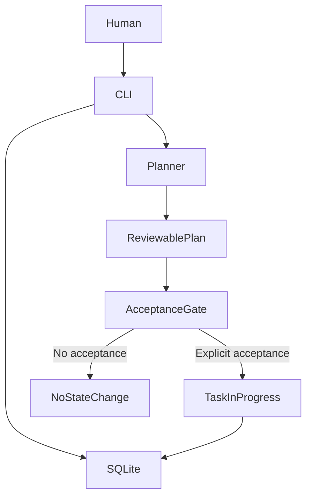

# AI-OS v0.1 architecture

AI-OS is a local-first Python control plane for recording projects, ranking tasks, and requiring explicit task acceptance.

## Verified boundaries

The CLI initializes SQLite, adds projects and tasks, ranks tasks, and changes a task to in-progress only when its identifier is explicitly accepted. A default `run` is a dry run. The demonstrated workflow does not execute external actions or run unattended cloud agents.

## Code layout

- `ai_os/`: Python CLI and local control plane.
- `tests/`: standard-library core tests.
- `apps/mvi/`: separate video intelligence application; not covered by the 112 root tests.
- `apps/signal-watch/`: separate application area.

See [release verification](RELEASE_VERIFICATION.md) for test evidence and unresolved security, licensing, and integration gates.
